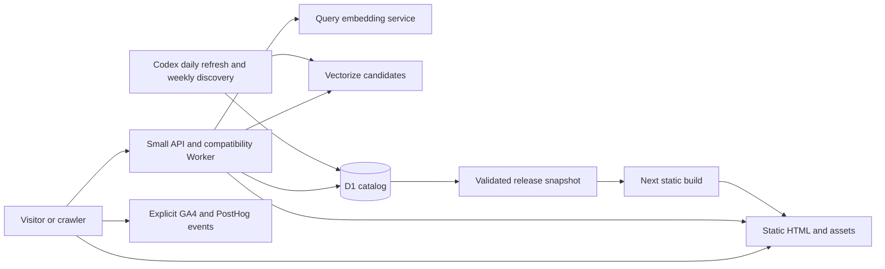

# Stupid Gifts launch and infrastructure specification

Date: October 19, 2026. Owner: Cameron. Canonical implementation epic:
`roadmap-lbbz1`. Baseline: `1a7ccb301f25dc129965fb71b32e0a682a86d604`.
Current status, October25 Pacific: `https://stupid.gifts` serves3,352public
gifts/31specific exclusions with all3,383identities and42original articles
preserved. The owner-reviewed full release is accepted on Cloudflare Free;
see `evidence/2026-10-25-full-catalog-accepted.json`. The redundant directory is
retired and the white, fully described gallery is live. Routine-cost observation,
semantic-search parity, show preparation and remaining provider/retirement work
remain separate follow-ups. Vercel stays frozen and Neon retained for rollback.

**October 21 launch authorization:** Cameron explicitly wants `stupid.gifts`
live as soon as essential checks pass. Do not wait for tomorrow, a broadcast
date, another visual approval, or an arbitrary prelaunch observation period.
Hosting and brand launch may happen together; keep the old service available
for rollback. The seven-day observation below is **after launch** and gates
destructive retirement, not launch. A valid nonempty catalog, content rights,
functional routing/search, HTTPS and recoverability remain real prerequisites.
Keep Cloudflare Free and the existing catalog limits. Optional provider
renames, creator research and physical show preparation must not delay serving
the new site. Record any exact account/access prerequisite rather than calling
all deferred work a launch blocker.

## Purpose and decisions

**October22 owner corrections:** Finish migrating the **whole catalog**, not
only the eight visible launch products. Preserve every product identity, slug,
native embedding, original editorial and history; a refresh deadline is not
authorization to delete or deactivate a gift or remove it from search. Separate
persistent cleared catalog content from supplier fields with genuine retention
limits. After a supplier image, API description or offer expires, omit/replace
that field with a compliant fallback while preserving a useful product page,
listing and retailer link. Do not solve this by extending rights, republishing
expired supplier data, or waiting for a 3,383-item backfill at ten items/day.
Current whole-product `eligibleUntil` guards remain a known implementation gap,
not the desired final catalog policy. Live pruning is paused pending this fix.
Canonical child `roadmap-lbbz1.3.2` requires full source-to-production count/hash
reconciliation, final source barrier/delta, broad browse/search coverage and
real recovery proof before migration completion.

Retire Weird Gift Index, its JSON endpoint, citations and schema completely;
return genuine 404/410s. Do not publish the owner's personal name, byline or
email anywhere on the public site. Keep truthful Thirty Seven Inc ownership
and verified `goosegifts@37.technology` product contact. Homepage heading is
**Stupid gifts. Excellent taste.** Remove repeated collection labels and the
duplicate Collection navigation tab; home is the primary browse surface with
24 initial gifts and static 24-item Load more batches. The October25 owner
decision retires the redundant `/gifts` directory, pagination and export aliases
with genuine404s; individual `/gifts/[slug]` product pages remain. Use restrained SVG
guide glyphs rather than numbered lists or platform-dependent arrow symbols.
Debounced keyword search uses the published catalog in Worker memory without
per-query D1/model work. Semantic serving remains off under `roadmap-lbbz1.4.7`;
per-keystroke embedding calls are not justified.
These corrections supersede conflicting older route/freshness/design language.

### Historical full-catalog completion sequence (not daily discovery)

The source-catalog/persistent-display migration and publication below are now
accepted. Preserve its evidence; do not rerun it. Semantic serving remains a
separate follow-up rather than permission to reduce the public catalog.

1. Reconcile the protected full source baseline and final delta with **production**
   D1. Staging's 3,383 identities are not production migration evidence; the
   production launch packet contains ten private products, eight publicly ready.
   Preserve source/native/history and any target-native records; inspect actual
   receipts before claiming missing records were deleted or restored.
2. Implement a persistent cleared-content product projection and field-specific
   supplier deadlines. Keep original editorial, stable identifiers/slugs and
   retailer navigation useful; replace only fields whose display rights expire.
   Preserve unavailable products without implying they can currently be bought.
   Add regressions showing refresh expiry cannot erase a product, its page or
   its search identity. Do not disable supplier-rights guards wholesale.
3. Bulk-migrate existing approved content and immutable history, not a thousands-
   item paid refetch/regeneration. Build the broad homepage feed, product pages
   and guides from that reconciled projection. Provide keyword coverage across
   the catalog; preserve all native embeddings privately and measure the eligible
   Vectorize subset against the existing Free quota before indexing. No paid
   upgrade or silent catalog reduction to fit that index.
4. Prove final source barrier/delta and recovery, compare actual counts/digests,
   and test representative old/new product URLs, broad search, static Load more,
   affiliate navigation and field expiry. Then publish Cloudflare and enable
   the single daily-ten maintenance job. Daily refresh is ongoing upkeep, not
   the migration mechanism. Keep the old site/data as rollback until verified.

Prepare the existing gift catalog for a recurring weekly segment on **Howie
Mandel Does Stuff** and the visitors it may bring. Optimize for products that
are funny at a glance, worth exploring, and actually purchasable. The first
success measure is qualified retailer clicks; affiliate earnings are the
business outcome. A broadcast date and audience volume have not been set.

Use **Stupid Gifts** as the proposed public identity and `https://stupid.gifts`
as the canonical destination. The owner authorized securing that exact domain.
The existing Goose site remains the production source until the staged
transition passes its gates. Keep the useful-absurdity editorial discipline:
outrageous objects, restrained presentation, accurate product facts.

**Domain receipt:** Cloudflare Registrar in the existing `37.technology`
account confirms `stupid.gifts` **Active**, purchased October 19 for $28.20.
Expiration: October 19, 2027. Auto-renew is enabled, currently quoted at
$28.20/year and scheduled for September 19, 2027. Domain ownership is complete;
the new domain's production HTTPS serving launched October 21. The old Goose
domain has not yet been redirected or decommissioned.

The final architecture is:

- **Cloudflare Workers Static Assets** for prebuilt pages, catalog fragments,
  brand assets, and share images.
- **Next.js static export with existing React components** as the build tool.
  Retain the familiar codebase; eliminate request-time Next.js rendering.
- **A small TypeScript Worker** for current keyword search, maintained URL
  redirects and field-level freshness guards. Semantic serving remains a
  separately verified follow-up, not a prerequisite for catalog availability.
- **D1** as the operational catalog and maintenance-history database.
- **Vectorize** for existing 1,536-dimensional product embeddings.
- **One existing Codex catalog task**, adapted to D1 and a release pipeline.
  Cameron approved daily refreshes of at most ten existing products and weekly
  discovery on October 21. The same task checks publication expiry and verifies
  deployments; it does not need a separate Cloudflare Cron or hosted build job.
- **GA4 and PostHog** through the current explicit event adapter. No Vercel
  Analytics, new tracking vendor, per-view database writes, or new account
  system.

The October 21 signed-in Workers plans page confirms the existing account is
on **Free ($0)**. No Workers Paid subscription has been purchased. Paid is an
explicit upgrade with a $5/month account minimum from activation, plus
overages; it does not activate automatically at a traffic threshold. Use
measured CPU/quota evidence to decide whether the launch needs that upgrade.
**Owner constraint: stay on Free.** First demonstrate an actual usage or
required-feature limit and assess a bounded Free-plan alternative; ask Cameron
for explicit approval before activating any paid plan. Expected podcast traffic
or a rehearsal is not purchase authorization. Do not exhaust the shared
account's daily quota with a provider-scale load test.
The suggested $15/month was planning headroom, not a required fee, subscription,
or hard billing cap. Other applications share the account's allowances. D1
removes Neon's awake-compute billing model, but inefficient queries still cost.

This spec does not depend on a new SSR adapter, an Astro rewrite, a CMS,
Durable Objects, Queues, R2, recipient accounts, reminders, wishlists, or a
Secret Santa product. Add a service only when an observed requirement needs it.

## Current system and constraints

The current site uses Next.js 16.3.5, React 19, Vercel, Drizzle/Postgres,
Amazon Creators API, and OpenAI `text-embedding-3-small`. Public contact is
`goosegifts@37.technology`; keep that verified alias until a new product alias
is created and verified. Ownership remains Thirty Seven Inc.

The October 19 provider audit found 80.14 of 100 monthly Neon CU-hours used,
19.86 remaining, scale-to-zero enabled after five minutes, and compute capable
of suspending. That is an urgent runway issue, not evidence that the prior
cache work failed completely. Month-to-date extrapolation suggested October
24–25 exhaustion; remeasure before relying on that estimate.

The same audit counted 3,383 products, including 3,180 active products with
1,536-dimensional embeddings. Database size was about 80 MB by SQL and about
104 MB in provider storage accounting. These are sizing baselines, not
migration reconciliation totals. Recount at export.

Source locations that determine compatibility:

| Concern | Current implementation |
| --- | --- |
| Query-dependent homepage and feed | `app/page.tsx`, `components/CatalogSearchFeed.tsx`, `lib/db/operations.ts` |
| Semantic and keyword search | `app/api/search-products/route.ts`, `lib/db/product-search.ts`, `lib/openai-embeddings.ts` |
| Product identity and freshness | `lib/db/schema.ts`, `lib/gift-slugs.ts`, `lib/db/gift-pages.ts` |
| Random selection | `app/random-gift/page.tsx`, `lib/db/random-gift.ts` |
| Share cards to replace with static product assets | `app/api/og/random-gift/route.tsx` |
| Guides and original index | `lib/gift-guides.ts`, `app/gift-guides/`, `app/weird-gift-index/` |
| Maintained redirects and site identity | `lib/gift-slugs.ts`, `lib/site.ts`, `next.config.ts` (obsolete bundle redirect map removed) |
| Catalog maintenance and receipts | `scripts/ops/catalog-weekly.mjs`, `prefetch-catalog.mjs`, `catalog-telemetry.mjs` |
| Events and privacy | `lib/client-analytics.ts`, `lib/analytics-contract.ts`, `lib/client-attribution.ts` |

Preserve immutable product IDs, public UUIDs, slugs and slug history, source
facts and hashes, editorial holds, duplicate families, freshness decisions,
review provenance, job IDs, and append-only operational history. Do not
resurrect retired bundle pages, the admin dashboard, or detailed click writes.

### Owner-approved feature retirement

Gift guides replace the old personalized bundle feature. Retire its generators,
top-level bundle URLs, redirect heuristics and unused runtime dependencies;
retired URLs return a genuine 404/410, not a generated page, guide redirect or
homepage fallback. Preserve current product/guide URLs and product slug history.

Remove remaining obsolete admin/auth/reporting code and do not recreate the
dashboard on Cloudflare. GA4 is the reporting focus, not a new first-party
reporting UI or detailed click database. Catalog maintenance, publication
authentication and minimal job/failure receipts remain operational necessities,
not a visitor-reporting feature. This scope decision does not remove the
existing PostHog adapter, Google Ads behavior or analytics privacy gates.

Retire `/random-gift?gift=<id>` compatibility and the query-based
`/api/og/random-gift` endpoint. No ID-to-slug map, gift-query resolver or legacy
share-card handler is required. Ordinary product URLs and static preview images
remain; Random links directly to the selected product page. Obsolete bookmarks
are not a compatibility contract. Cameron authorized removal of the six legacy
Pinterest Pins that used this format; all six are deleted and the other 28 Pins
are unchanged. Receipt:
`pinterest-creative-lab/legacy-share-retirement-2026-10-19.json`.

## Serving architecture

Create isolated staging and production D1 databases, Vectorize indexes, Worker
bindings, and publication credentials. Resource names follow
`stupid-gifts-{environment}`; IDs must come from provider creation responses.
Use the existing `37.technology` Cloudflare account, which also owns
`goose.gifts`. Do not reuse another app's database, index, or secrets.

### Routes and behavior

| Current or new URL | Final implementation and compatibility |
| --- | --- |
| `/` | Prebuilt curated opening selection, crawlable product links, progressively loaded static feed; a thin Worker checks snapshot expiry without D1 access. |
| `/?q=...` | Same static shell; client reads query and calls the search API. Search results remain usable/bookmarkable; the root Worker sets `X-Robots-Tag: noindex, follow` on query variants. |
| `/search` | Preserve its current redirect/query behavior in Worker routing; do not turn it into an unrelated page. |
| `/api/search-products` | Working database-free keyword search over the published catalog, with the existing response shape and abuse limits. Semantic serving is a separate, uncompleted follow-up, not a launch prerequisite. |
| `/api/catalog-feed` | Preserve bounded POST compatibility using the published catalog artifact, not D1. New browsing uses small static feed shards. |
| `/gifts` and pagination/export aliases | Retired404 by owner October25. Omit from navigation, sitemap and generated directory output. Home, search and guides replace this redundant directory. |
| `/gifts/[slug]` | Prebuilt product HTML, metadata, related products and share card. Thin Worker expiry guard serves the asset or a safe noindex fallback without querying D1. Existing slugs do not change for branding. |
| `/gift-guides` and `/gift-guides/[slug]` | Prebuilt existing guides with current eligibility and internal links. |
| `/random-gift` | Static useful initial selection plus client-side spinning over a bounded versioned eligible pool. No DB request per spin. Preserve no-immediate-repeat; link/share the selection through its normal `/gifts/[slug]` URL. |
| `/weird-gift-index` and its data/companion paths | Retired by owner October22; genuine 404/410, no schema, citation, JSON endpoint or public links. |
| `/privacy`, robots, sitemap and verification files | Static artifacts. Retain `/sitemap/0.xml` compatibility while publishing `/sitemap.xml` directly. |
| Retired bundle, admin/auth/report and `/api/og/random-gift` paths | No handlers or feature parity required; return a real 404/410. Product slug-history redirects remain, but bundle redirects and gift-query resolution do not. |
| `/howie` | New static weekly selection and links to the actual products; previous episodes remain reachable. |
| `/howie/[episode]` | Stable dated episode page, exact product variants, show order, archived alternatives for unavailable items. |
| Authenticated catalog publication endpoint | Replace Next cache invalidation with authenticated build dispatch/status. An accepted dispatch is not a completed release. |

Keep Worker routing explicit: root, catalog/guide/product/episode pages,
random, catalog data and sitemap go through a small bundled-manifest expiry
check; maintained API and redirect paths have their specific handlers. CSS,
JavaScript, owned images, fonts, privacy and other timeless assets use direct asset
serving. A Worker execution still counts as a request even when it returns
prebuilt HTML. This design removes database and rendering work from browsing,
but does not promise every page view is free.

### Next.js refactoring

Use `output: 'export'`; generate finite dynamic paths with
`generateStaticParams()` from a validated snapshot. Remove runtime
`searchParams` reads, `force-dynamic`, ISR/revalidation, request-dependent
metadata, and Next redirects/rewrites from the exported app. Move dynamic
handlers outside `app/` into `workers/site/`. Client query handling must
hydrate cleanly, retain back/forward behavior, cancel superseded searches,
and show loading, empty, and unavailable states.

A publication build reads one local immutable snapshot; components do not
open a database connection during rendering. Export all maintained guide pages,
product pages including safe held-page
responses, product slug-history redirects, and episode pages. Guard against
accidentally exporting raw source facts, embeddings, internal notes, or credentials.

Reuse `ProductGrid`, `ProductImage`, retailer CTA and sticky mobile CTA,
search/feed UI, analytics adapter, ranking/deduplication functions and
structured-data helpers. `ProductImage` already uses `unoptimized`; audit the
remaining image components rather than adding a new image service. Prebuild
owned assets at sensible widths. Merchant images remain on approved merchant
CDNs; verify their applicable caching/content license before copying them or
embedding them in durable generated assets.

Suggested small module boundaries, not a new generic platform:

- `lib/catalog/`: pure types, eligibility, ranking, deduplication and links.
- `lib/catalog/storage/`: temporary Postgres adapter, D1 adapter, snapshot reader.
- `workers/site/`: search, compatibility, freshness and publication authorization.
- `scripts/catalog/`: export/import/reconcile, snapshot and publish commands.
- `content/show/`: versioned episode manifests using stable public product IDs.

Delete obsolete provider wrappers only after all maintained CLI and prototype
consumers have moved. The private ChatGPT prototype has a separate owner and
acceptance process: preserve its catalog contract, inventory its dependency,
and coordinate its data adapter before removing Neon access. Do not publish
or redesign that prototype as part of this website migration.

## Catalog data and search

### Content rights and price boundaries

Launch with **“Check price on Amazon”** wherever a compliant current offer is
unavailable. A zero/unknown database price must not become a free-product
claim, a budget-category assertion, or a schema `Offer`.

Amazon's current policies permit displayed prices/availability from Amazon's
linking tools or Creators/PA API, subject to the license. They limit cached
non-image Program Content and image links to 24 hours, prohibit caching the
images themselves, and require timestamp/disclaimer treatment for offers
refreshed less often than hourly. SerpApi output is not that permission.
See the [Amazon policies](https://affiliate-program.amazon.com/help/operating/policies).

Therefore separate **editorial eligibility** (the existing 35-day gate) from
**merchant-content permission/expiry**. Inventory provenance for titles,
images, descriptions, source payloads, generated derivatives, embeddings and
archived snapshots before exporting them. A generic database backup policy
must not silently grant indefinite retention or reuse rights. Record affected
fields and a compliant migration/retention decision; do not mass-delete
existing evidence under this planning request.

The baseline static release uses independently owned/licensed editorial and
assets, factual product identity and retailer links. Where a route still uses
API content, refresh it within its permitted window or serve the safe version
without that content. Merely hiding the visible price is insufficient if stale
merchant content remains in HTML, JSON-LD, feed shards, share cards or cached
responses. No service-worker/localStorage cache of merchant Program Content.
Do not bake API images into long-lived OG, Pinterest or show assets without
separate rights.

**October 21 owner-approved operation:** reuse `goose-gifts-daily-ops` as one
daily Codex task. Refresh at most ten existing products per Pacific calendar
day, prioritizing explicit featured products and published pages. Reserve the
allowance before dispatch so an interrupted run cannot repeat unbounded work.
Tuesday–Sunday refreshes perform no discovery or model enrichment. Monday
may re-enrich changed/missing copy or vectors only within the same reserved
ten-product selection, reusing its original merchant response; approved unchanged
copy/vectors are reused. Run discovery once in that weekly lane with existing
quality, family deduplication and
net-new limits; do not also run the old 50-item revalidation or 25-item existing
backfill outside the daily allowance. Rebuild the site at most once after the
accepted changes, or when a publication deadline requires it. Updating existing
product and guide listings does not require generating new guide copy daily.

Missing/unavailable/changed-but-unreviewed facts remain held; deadlines derive
from real observations, never job/write time. Ten refreshes do not confer
freshness on the rest of the catalog. A delayed daily run may cross the
24-hour boundary, so the independent expiry guard remains mandatory. The
existing private local workspace supplies durable progress for this operating
model. Validate the command before changing the existing task in place; do
not create another catalog automation.

Optional price work starts with a maximum 12-product offline/controlled
Creators API probe; both repositories already request
`offersV2.listings.price`. Measure actual exact-variant coverage before adding
a provider. Preserve amount in minor units, currency, condition, offer/variant
identity, source, observed time and expiry independently of editorial dates.
Do not substitute list price, a range minimum, coupon/member pricing or another
seller/variation for the selected offer. Expired/absent offers disappear from
every public surface; the retailer CTA remains. This enhancement must not block
launch of a useful price-free experience.

### D1 data model

Preserve catalog semantics explicitly rather than mechanically importing a
Postgres schema:

| Postgres representation | D1 representation |
| --- | --- |
| UUID/product IDs/slugs | TEXT with the same values and unique constraints |
| Decimal money | Integer minor units plus currency; represent unknown price explicitly and preserve existing unknown-price behavior |
| Quality/similarity scores | REAL, with precision tolerance tested against exported values |
| Booleans | INTEGER restricted to 0/1 |
| Timestamp with timezone | UTC ISO-8601 TEXT with one canonical format |
| Historical timestamp without timezone | Interpret according to its documented writer semantics; test against known receipts, never guess local timezone |
| JSONB and tag arrays | Validated JSON TEXT; dedicated indexed columns for fields used in filters |
| Bigserial sequence | Preserve existing integer values/order; allocate new sequence atomically after the imported maximum |
| pgvector embedding | Vectorize plus a protected export copy; not a public JSON artifact |
| GIN/HNSW indexes | Purposeful D1 B-tree/FTS indexes and Vectorize cosine index |

Implementation clarification: where no historical writer timezone can be proven,
preserve the exact original wall-time text and provenance in the protected record,
and leave the normalized historical instant NULL. Unknown verification time holds
a product out of public projections and semantic eligibility until a genuine new
verification. Do not rewrite old history as the import time. This is a documented
lossless raw-data mapping, not a claim to have reconstructed missing timezone facts.

Migrate active and inactive `products`, `product_slug_history`,
`catalog_runs`, `catalog_run_items`, `catalog_editorial_events`, and maintained
search diagnostics. Capture a complete protected export of every source table
including legacy bundles, relationships, clicks, admin actions and error logs.
Retired bundle/admin/reporting history belongs in a separately verified offline
archive, not runtime D1. Every source table must have a recorded destination and
restoration test, subject to the content-rights retention review above. No
source data deletion is implied.

Where retained search history refers to archived bundles, preserve the old
reference values as historical fields with an archive mapping; do not create
broken D1 foreign keys, discard the references, or rebuild the retired bundle
tables solely to satisfy an unused relationship.

Add narrowly scoped `episodes` and `episode_products` data (or validated
version-controlled manifests) with episode key/date/status, product public ID,
display position, factual caption, approved asset, and replacement ID.
Choose manifests initially: no CMS or additional editorial database is needed.

Add `catalog_revision`/publication receipts and an idempotent vector-sync
outbox. D1 product update and outbox insertion are one transaction. The
maintenance runner drains the outbox, upserting/deleting Vectorize records;
each record includes source revision and embedding-text hash. A failed index
update remains retryable and visibly pending.

### Search behavior

Keep the existing embedding model and dimension during migration. Never
query an index with embeddings from a different model or dimension. Export
existing vectors without paying to regenerate all of them; recompute only
missing/changed inputs after the baseline is reconciled.

Use stable public UUIDs as Vectorize IDs, cosine similarity, and small
filterable metadata for eligibility and catalog revision. Retrieve bounded
candidates, fetch their D1 records in bounded indexed batches, then apply the
same eligibility, quality ranking and product-family deduplication. Treat
Vectorize metadata as a candidate filter, not final availability authority.
Keep the current retailer/product identity mapping for existing clients.

Preserve the current search result cap of 60. A maximum 240 candidates matches
the current overfetch intent; chunk D1 ID queries below its bound-parameter
limit. Do not silently replace search with a 3,000-row scan. Use an FTS5
keyword index for fallback and compare actual query plans/rows read.

Use a two-character minimum, 200-character maximum, bounded request size,
short provider timeout, and per-client rate limiting. Submit on search
intent/debounce, not every keystroke. Cache safe normalized results for five
minutes keyed by query hash, model version and catalog revision; purge by
revision on publish. The cache is an optimization, not a correctness or
globally strict spending lock.

Preserve first-party search diagnostics with capped fields and explicit
retention; do not forward raw query text to GA4, PostHog or general logs.
Logging failure must not fail a usable search. Include a configuration kill
switch for semantic search: if embedding/index quota or budget is exhausted,
serve keyword results and static browsing. Do not retry failed external calls
unboundedly. Search-provider failure must never blank the homepage or product
pages.

### Publishing and expiry

Every release has a manifest containing code SHA, catalog revision, generated
time, next expiry, product/slug counts, vector-sync watermark, content checksums
and the prior known-good release ID. Public files contain only approved
display fields. Shard feeds so a first visit does not download the whole
catalog.

Build and publish after an approved catalog/episode change, coalescing work
into one release. The daily existing-product allowance is ten, including
Monday; weekly discovery retains six rotating themes, existing net-new limits,
deduplication, factual checks and `--no-notify`. Replace invalidation with a
verified publication receipt. A provider HTTP 200 does not prove the new
catalog reached users.

The same Codex task performs the daily **publication freshness check**. It
reads the current revision/deadlines and rebuilds only after accepted changes
or when eligibility/content expiry requires it. Use the canonical private
workspace and D1 mutation fence to prevent overlapping publication; verify the
actual published revision and record completion. Dispatch acceptance is not
success. The local computer and desktop app must be available for the task;
the deployed site and bundled expiry guard continue operating independently.
Cloudflare Cron plus Workers Builds is a possible later replacement, not a
second scheduled owner or a launch prerequisite.

Preserve the 35-day indexability gate and stricter merchant-specific content
expiry rules. At build time compute each page's `eligibleUntil`. Bundle this
small expiry map in the Worker: after expiry serve a prebuilt safe noindex
variant and exclude expired entries from crawler sitemap responses, without
a database request. Keep price/offer claims out of the safe variant; preserve
useful navigation and a factual retailer link where permitted.

Homepage/episode/feed artifacts have their own earliest-expiry guard and safe
fallback as well; protecting only detail pages would still surface stale
recommendations. The Worker serves the normal asset while valid and a
prebuilt fallback when publication stalls. No browser-only timer can enforce
crawler-visible freshness. If a whole feed expires, show the safe browsing
message and maintained navigation; never replace an expired feed with empty
200 responses that look like a healthy catalog.

Cap HTTP/browser/shared-cache lifetimes at the applicable expiry timestamp.
Do not let a cached successful response bypass the guard after expiry.
Reserve long immutable caching for content-addressed owned assets; search
cache lifetime must also respect the returned products' eligibility deadline.

Generate an immutable release package and deploy its HTML, manifests, Worker
and owned assets as one version. Keep historical asset paths through the
cache lifetime to avoid broken client navigation after a deployment. Publish
only after vector outbox reconciliation, snapshot validation and route QA.
An urgent product removal triggers the same small release path with a target
of 10 minutes, not a week-long wait for discovery.

## Data migration and cutover

### Stage 0  Protect the current service

Remeasure Neon usage, time-to-exhaustion and active wake sources. Investigate
the remaining uncached `getProductById` calls on random/shared OG requests.
Any immediate patch must be narrowly verified; do not claim it eliminates
all compute. If migration cannot finish inside the remaining allowance,
present an exact temporary provider cost/term before upgrading. Do not use
quota pressure to rush a destructive cutover.

### Stage 1  Prove a complete vertical slice

In an isolated branch, publish a protected/noindex Cloudflare staging build
with the homepage, one guide, representative ready/held product pages, a
random spin linking to a normal product page, and real search over a small
copied D1/vector cohort. Use a staging analytics configuration that cannot
pollute production.

Pass static export, asset routing, Worker expiry, D1 binding, Vectorize parity,
and mobile interaction checks before converting every route. The production
Vercel app continues serving its current version.

### Stage 2  Export and reconcile

1. Inventory every source table, count, key, foreign-key relationship, nullable
   field, time representation, maximum sequence and operational consumer.
2. Take a consistent, read-only export through the existing HTTPS Postgres
   path. Use a repeatable snapshot if supported; otherwise pause catalog
   writers briefly, export deterministically, and reconcile any diagnostic
   writes by high-water mark. Do not stream a live-changing multi-page catalog
   and call it a consistent backup.
3. Store encrypted/private export artifacts outside Git/public assets. Include
   table manifests, SHA-256 checksums, schema version and exporter revision.
4. Import into staging D1 in idempotent, size-bounded batches with preserved
   identities and uniqueness. Set explicit ordering and parent-before-child
   relationships; validate foreign keys and transaction boundaries.
5. Import vectors using the original values and an ID mapping manifest. Wait
   for index mutation visibility; compare count, dimension, ID coverage and
   representative query results. Count equality alone is not parity.
6. Reconcile all product IDs/public IDs/slugs/history, hashes, flags, money,
   timestamps and receipt sequences; record every approved transformation.
   Validate archived tables by restoring them into a disposable local database.
7. Compare a fixed 30-query search set, including recipient descriptions,
   exact products, typos, empty results and provider failures. Require no held
   or duplicate-family results and at least 80% top-10 overlap on the baseline
   set; manually review differences because approximate vector ranking may
   legitimately reorder candidates.

### Stage 3  Move writers and secrets

Keep Neon authoritative until the final write barrier. Avoid indefinite
dual-writing. Disable overlap between catalog runs during the barrier; record
the last successful run/revision, copy the final catalog delta, reconcile,
and change the runner to D1 exactly once. Resume only after a dry run proves
the new target and one bounded write/run produces durable receipts.

Cloudflare cannot export Worker secret values back to the local runner.
Therefore replace Vercel env-pull with an explicit protected operator
configuration in macOS Keychain on the Codex operator host, and
deploy the required subset to Worker secrets. Keep `AMAZON_ASSOCIATE_TAG` in
one canonical non-secret catalog configuration consumed by runner, publisher
and tests; do not hardcode a second tag. Seed from the currently verified
Vercel Production value and record the configuration-source transition.

Inventory Amazon, OpenAI, analytics public keys/hosts, Pinterest OAuth
refresh, publication auth, and provider credentials by name and consumer.
Never put personal API tokens, exports or secrets in build output or Git.
Use project-scoped runtime credentials and isolate preview from production.
Replace the catalog heartbeat's `pull-env.sh` dependency only when the new
bootstrap has been exercised. Keep the Pinterest cohort measurement-only
until separately authorized; update URL/credential configuration without
publishing new Pins.

### Stage 4  Move hosting, optionally together with the new brand

Serve the complete compatible site on Cloudflare staging first. Record the
current DNS, TLS, security, Vercel deployment and Neon recovery references.
Move the ready public site directly to `stupid.gifts` when that is the fastest
safe path; an intervening Goose-branded hosting launch is not required. Use
separate production resources and preserve protected staging. Move existing
Goose routing only when maintained paths have matching destinations; do not
redirect functioning product links into an empty or unrelated catalog.
Preserve MX/TXT/email, verification records and unrelated Cloudflare settings.
Verify HTTPS, redirects and production browser events.

Hold the old deployment and a known-good data export for a seven-day
observation window. Leave Neon suspended where possible; repeated health
checks must not keep it awake. Recovery after D1 writes requires exporting
the D1 delta back to the restored source before re-enabling the old writer.
Simply switching DNS to stale Neon is not a valid rollback.

### Stage 5  Launch the new brand

Launch the approved visual treatment on `stupid.gifts` as soon as essential
release checks pass; the owner has authorized the public cutover. Do not wait
for another day, an airing date or a second launch approval. Redirect
`www.stupid.gifts` to the apex and maintained Goose
public paths permanently to their matching new paths, preserving safe
attribution parameters and search behavior, excluding the retired features
above. Serve those redirects on Cloudflare, independently of Vercel/Neon.
Keep at least a year of redirects
from the actual brand cutover; the deferred old-domain renewal decision below
must preserve that window.

Update canonical/OG/schema URLs, sitemaps, robots, public contact presentation,
favicons, web manifests, social/share assets, legal ownership, analytics
production-host allowlists and Google stream settings. Keep GA4
`G-6RR3HPR747`, Google Ads `AW-17626116539` and the existing Goose PostHog
project so measurement remains continuous. Verify one stored page event and
one stored retailer event in each provider, with QA traffic identified.

Register the new site in the Amazon Associates approved site list and any
active affiliate program before monetizing the new domain. Retain the
verified tag; a rebrand is not a new affiliate account. Verify Pinterest
claimed-site/app metadata and remaining Pin product-page destination redirects;
do not delete further Pins without exact approval. Coordinate Search Console
verification, sitemap submission, Change of Address and Bing/IndexNow with
the existing search-submission owner.
Track actual provider receipts separately from website code completion.

### Provider and automation cutover checklist

Code completion does not close these provider steps. Complete them against the
existing accounts, preserving continuity rather than creating replacement apps
or changing the affiliate tag to match the new brand.

**Timing:** all provider-facing rebranding below is deferred to the final
launch stage, after infrastructure and design are ready (`roadmap-lbbz1.8`).
Do not change accounts, Google settings or public identities during spec work.
In that final stage, complete required ownership/domain allowlists before
traffic or monetization moves; submit search-move notices only after the new
site and redirects work. This is a coordinated launch checklist, not a reason
to postpone functional prerequisites until after launch.

**Google and analytics — final-stage continuity checklist.**

- **GA4:** identify the existing property and web stream by the live
  `G-6RR3HPR747` measurement ID. Update property/stream display names and
  website URL to Stupid Gifts / `https://stupid.gifts`; retain IDs, historical
  data, events, conversions, privacy controls and access. Review linked
  Search Console/Ads properties, hostname filters and referral/cross-domain
  settings for the actual transition; do not enable additional collection.
  Verify stored QA page and retailer events on the new host without duplicate
  redirect pageviews. [Google's editing guidance](https://support.google.com/analytics/answer/9304776?hl=en)
- **Search Console:** retain the Goose properties and history; add and verify
  `stupid.gifts` under the correct owner with operator/service-account access.
  Once canonical URLs, robots, sitemap and permanent path-preserving redirects
  are live, submit the new sitemap and use Change of Address from the eligible
  old property. Coordinate with the existing search-submission task, record
  submission receipts, and compare both properties at 7/14/28 days. Verification
  or a submitted request is not proof of indexing or recovered rankings.
  [Google's move checklist](https://support.google.com/webmasters/answer/9370220)
- **Google Cloud / Google Auth Platform:** inventory the exact project(s),
  OAuth clients, service accounts, API-key restrictions and discovery/search
  tooling actually used by Goose. Update Goose-specific display/consent
  branding, homepage/privacy/terms URLs, verified authorized domains and
  required origins/callbacks; leave shared Thirty Seven projects unchanged.
  Preserve project/client IDs, scopes, IAM, billing and working credentials.
  Keep loopback callbacks unless their implementation changes. Where brand
  verification is required, finish verification/publication and prove the
  affected auth/API flow; do not assume saving draft branding publishes it.
  Do not revive retired Google login merely to rebrand it.
  [Google's brand-verification guidance](https://developers.google.com/identity/protocols/oauth2/production-readiness/brand-verification)
- **Google Ads and PostHog:** retain `AW-17626116539`, the existing Goose
  PostHog project and measurement history. Review project names, site URLs,
  domain filters, conversion destinations, dashboards and portfolio reports.
  Inventory any Ads final URLs/assets and linked accounts; keep paused
  campaigns paused and obtain separate campaign-change authority where needed.
  This checklist does not authorize ad spend or add a tracking provider.

**Other services — inventory before final cutover, not a blind rename.**
Check repository configuration, secret **names** and consumers, CI workflows,
scheduled prompts and provider account inventories for `Goose`, `goose.gifts`
and brand-dependent URLs. Record each service's exact account/resource,
current setting, intended change, timing, rollback and verification receipt;
mark unused services not applicable with evidence. Never record secret values.
Include:

- Bing Webmaster Tools / IndexNow, domain-verification files and DNS TXT
  records; preserve old-domain verification and redirect ownership.
- Cloudflare domain/TLS/security settings, GitHub deployment environments and
  callbacks, remaining Vercel/Neon integrations and monitoring/usage alerts.
  Keep the old-provider rollback path until its separate retirement gate.
- Google Workspace/contact aliases, support/reply-to links and mail DNS.
  Keep `goosegifts@37.technology` working; use a new alias only after creation
  and delivery verification, without exposing a personal address.
- Amazon/Pinterest steps below, OpenAI and other API-provider project labels
  or domain restrictions where applicable, and the private ChatGPT app's
  metadata/allowed domains through its owning task.
- Existing social/profile/directory links, the 37.technology portfolio card,
  QR/show links, legal/affiliate copy, status/report labels and automation
  inputs. Preserve historical receipts; outreach, app submissions, handle
  changes and changes to another product retain their own approval boundaries.

Close this checklist only when each applicable entry has a provider readback
and a working-flow receipt. Record owner-visible blockers and keep unresolved
launch requirements open. Renaming a dashboard alone does not prove that
authentication, attribution or links work.

**Amazon — final pre-launch gate (`roadmap-lbbz1.8`).** October 19 technical
readback: Vercel Production supplies `goose-gifts-37-20`; all 3,383 stored Amazon
URLs have exactly one matching tag, HTTPS Amazon host and matching ASIN path.
The live random page and three sitemap product pages expose that same tag.
Home and guides link to site product pages, so an absence of direct retailer
anchors there is not a tagging failure.

Persisted account evidence identifies parent Store ID `rileyehrlic0b-20`.
This session could not independently verify that ownership: Chrome 37 is
signed into `mikeideas-20`, and Chrome Personal requires sign-in. The owner
explicitly deferred the correct-account login and website-list update to the
end. Do not change the Mike Ideas account or copy its tag/campaign entitlement.

At the final gate:

1. In the wife's correct Associates account, verify the dedicated tag appears
   in Manage Tracking IDs and preserve a redacted receipt. Inspect applicable
   account eligibility/payment warnings without changing tax or payout details.
2. Once the new domain serves useful public content, add `https://stupid.gifts`
   to that account's website list and read back the saved list; retain Goose
   URLs and other existing properties. A saved entry is not a claim of separate
   Amazon approval. If necessary stage the new public site without monetized
   links, complete the account gate, then enable the final launch.
3. Test the ordinary user path: Pinterest/episode link → intended product page
   → explicit retailer CTA → exact Amazon product/tag. Analytics blocked or
   opted out must not alter navigation. No auto-redirect to Amazon, self-buy,
   manufactured orders, or repeated clicks to inflate reports.
4. Use an official link checker if available and tag-filtered Associates
   clicks/orders/earnings reports with their actual date range and reporting
   delay. Separate **tag ownership**, **valid navigation**, **reported clicks**
   and **credited commissions**. With no qualifying purchases, commission
   attribution remains unproven; do not hold launch hostage to a test purchase
   or present correct URL syntax as revenue proof.

**Pinterest — same app and business account (`roadmap-lbbz1.8`).**

- Preserve app `1588384`, business account `1107815345747925810`, existing
  boards, approved production access, scopes, tokens and remaining public Pin IDs.
  Capture before-state and recheck current account identity before edits.
- At brand launch update developer-app name/description/icon, website and
  privacy URLs wherever those fields exist. Verify the existing application
  stays approved; if Pinterest requires re-review, record that gate and
  keep the last working integration until resolved. Do not create a new app.
- Audit callback URLs against the actual OAuth client. The present CLI uses
  `http://localhost:3737/oauth/pinterest/callback`; a site rebrand is not a
  reason to replace that working callback. Any future hosted callback needs
  its own implementation and exact allowlist validation.
- Update the public profile display name, bio, avatar and website together
  when the destination works. Keep `goosegifts` as the handle initially; a new
  handle requires availability and old-profile-link review, not an assumption.
  Claim the new domain with Pinterest's supplied DNS/HTML verification and
  confirm the provider shows it claimed. Retain the old claim where supported.
- Update future draft destinations, canonical-host guards, asset hosts,
  UTM/link builders and the creative skill's brand inputs. Treat any changed
  package as a new digest requiring normal validation; never rewrite historical
  approval/publication receipts. Follow remaining Pin product links through the Goose
  redirects to the matching new product, preserving safe campaign parameters.
- Run production OAuth refresh, account/board reads and a create **dry run**.
  Read verification is required; a rebrand alone does not authorize a test
  post, deletion/reposting, Sandbox publication or a new experiment.

**Scheduled work — update in place, not by creating duplicate jobs
(`roadmap-lbbz1.4`).** Snapshot each current prompt, target, cadence, timezone
and status before editing through its owning scheduler. Do not rename the local
checkout or credential namespaces simply to match the public brand.

| Existing owner | Current behavior | Required migration and acceptance |
| --- | --- | --- |
| `goose-gifts-daily-ops` | Daily Catalog Care; daily 08:30 Pacific, Monday-only discovery; Neon until cutover | Preserve ID/thread and the ten-product daily reservation, use the tested daily command with explicit backend, replace Vercel bootstrap only after protected replacement works, and verify real publication receipts. Keep Free-only/renewed-approval guard. No separate Slack report. |
| `goose-gifts-pinterest-growth-studio` | Daily 09:30/16:30 Pacific; now measurement-only after P6/F6 | Preserve target thread, completed cohort and exact October 31 16:44:52.279 UTC review gate; update name, brand/destination config and cross-domain analytics at cutover. Verify one measurement-only run. No restart of posting without a new experiment authorization. |
| Daily portfolio pulse | Consolidated owner metrics; local `37cli` Goose adapter still reads historical database events | Replace the retired database click/search source with existing GA4/PostHog receipts, update display/domain filters and preserve property IDs/historical Goose data. Coordinate with its owner; the inspected `37cli` files are unrelated dirty work. Verify one report without waking Neon, double-counting redirects or creating a separate report job. |
| Publication freshness check | Part of the same Codex catalog task | Reuse its workspace/lock; test unchanged, expiring, failed and interrupted publication and prove the deployed revision. Cloudflare Cron/Builds remains an optional later migration, not another job. |

Keep scheduled captions and names consistent with the new brand, but immutable
experiment IDs and historical results remain Goose-era facts. Local scheduled
jobs depend on their host being available; independent Worker expiry guards
must protect public output if that host or the publication scheduler is down.
Record the existing automation ID, operator checkout/workspace, command and
explicit backend during the verified handoff. Keep failed/missed-run evidence
in the task and existing consolidated portfolio metrics.

Only retire Vercel/Neon after the observation window, verified restoration,
maintained consumer migration and secret-bootstrap replacement. Source data
deletion and paid subscription changes require their own concrete action
approval; removing an app dependency is not permission to delete its history.

### Stage 6  Cleanup and decommissioning

Track in `roadmap-lbbz1.7`, after the launch and at least seven healthy days.
Planning does not authorize deleting resources, renaming the repository,
changing domain renewal or editing the portfolio now. Complete the following
in recoverable steps, with exact resource IDs and before/after receipts.

1. **Prove independent redirects first.** Test HTTP/HTTPS and apex/www Goose
   URLs through Cloudflare to matching Stupid Gifts pages, including product
   slugs, guides, the random page and safe campaign parameters. Keep real
   404/410 behavior for retired content; do not send every missing URL to the
   homepage. Confirm TLS, domain ownership and verification records survive
   removal of old hosting. Keep redirect monitoring lightweight and independent
   of Neon. [Google recommends at least one year of redirects](https://developers.google.com/search/docs/crawling-indexing/site-move-with-url-changes).
2. **Retire only this project's Vercel and Neon resources.** Inventory exact
   projects, deployments, branches, integrations, jobs and billing items.
   Prove restored exports and D1 delta recovery, capture protected configuration
   and receipts, and verify every maintained consumer uses the replacement.
   Remove obsolete deployment hooks/Git integration, required status checks,
   Vercel env bootstrap and SDK/config references only after replacements work.
   Revoke project-only credentials once unused; never revoke shared team tokens
   or uninstall an organization-wide integration. Obtain exact deletion/billing
   approval at execution, then read back retirement and check that old usage
   stops. Re-test the site, weekly runner, publication and redirects afterward.
   Do not delete shared Vercel/Neon accounts, analytics history or recovery data.
3. **Rename the existing GitHub repository, not recreate it.** Planned target:
   `37-Inc/stupid.gifts`, subject to availability and execution approval.
   Preserve repository identity, commits, PRs, issues and protections. Before
   renaming, inventory remotes, CI/deploy hooks, Cloudflare Git connections,
   OIDC trust, reusable workflows/actions, badges and docs that use the old
   path. Update and exercise them, including a build/deploy and scheduled
   publication dispatch. GitHub redirects do not cover calls to hosted actions;
   do not reuse the old repository name. Local checkout paths and schedule IDs
   may remain stable unless a separate path migration is needed.
   [GitHub rename behavior](https://docs.github.com/en/repositories/creating-and-managing-repositories/renaming-a-repository)
4. **Update the 37.technology listing and owned links.** At brand launch,
   follow that repository's normal review/deploy workflow to update the name,
   approved catalog-first copy, destination and artwork. Verify the live card,
   its link and any applicable metadata/schema; check other owned profile,
   README, QR and documentation links. Record this receipt in the retirement
   checklist rather than leaving the portfolio on the old identity for the
   observation week. Preserve historical records and product-contact privacy;
   external outreach remains separately authorized.
5. **Defer disabling `goose.gifts` auto-renew until expiry is reconciled.**
   Record the actual old-domain expiration, next renewal attempt, launch date
   and minimum redirect-retention end date; do not reuse the new domain's
   dates. Turning off auto-renew leaves only the already-paid registration
   term, not permanent redirect ownership. If it cannot cover at least one
   year after cutover, keep renewal unchanged and bring the exact extension
   or shorter-retention tradeoff to Cameron. Before an approved switch-off,
   record a dated follow-up before the renewal-attempt deadline and before
   expiry. Recheck remaining Pin/backlink traffic, email, verification and
   takeover risks before allowing the domain to lapse; never delete its
   Cloudflare zone or TLS while redirects are required. Cloudflare currently
   starts auto-renew attempts about 30 days before expiration.
   [Registrar renewal behavior](https://developers.cloudflare.com/registrar/account-options/renew-domains/)

Retirement acceptance requires a resource disposition list (removed, retained
with reason, or blocked), recovery locations/retention, final usage/billing
readbacks, a working renamed-repository deployment, the live portfolio receipt
and independent redirect tests. The old redirect domain is an intentionally
retained asset, not an orphaned hosting resource. Record its dated renewal/
retention follow-up before closing infrastructure retirement; an unresolved
future domain decision must not be silently marked complete.

## Visual design and show experience

### Editorial direction

**Stupid Gifts** should feel like a well-designed collection of very bad ideas.
Keep the interface confident and quiet so the objects provide the joke.
The owner-approved homepage heading is “Stupid gifts. Excellent taste.”

Use white, near-black type, and the existing warm orange as a restrained
accent. Start with the current accessible burnt orange `#c2410c` for small
interactive text; check contrast in context. Use clean Inter typography,
moderate weights, generous product image space, and short captions. Avoid a
giant introductory paragraph, novelty fonts, shouting sale banners,
stickers on every tile, and a wall of equally weighted mugs.

The goose can remain a tiny signature or easter egg. It must not confuse the
new name or occupy space needed for products. Do not introduce a new mascot
system. Do not publish “as seen on” claims, show logos, clips, endorsements or
host imagery before the relevant appearance/asset permission is confirmed.

### Homepage and episode layout

First viewport: compact wordmark/nav, the approved short heading and easy-to-find
search, followed by the curated first24 in a three-column desktop/two-column
mobile gallery. Every home, Load more, guide and search card shows an image,
title and short description. Preserve original catalog copy; exact-ID/title
factual presentation notes may replace generic placeholders without rewriting
original editorial or native history. Do not introduce a long hero.

When there is an actual published episode, provide a clear “From the show”
entry and direct links to that week's products. Below the opening set, offer
collections such as “Desk crimes,” “Bathroom nonsense,” and “Gifts that
shouldn't work,” only where the catalog genuinely supports them. Preserve
occasion guides as a second browsing path.

`/howie` shows the current published episode, two or three lead products in
the order discussed, one factual sentence each, a visible retailer action,
and previous weeks. Draft episodes are absent from public routes. Each
`/howie/[episode]` URL remains stable; if an item becomes unavailable, say so
and offer a clearly labeled substitute rather than silently rewriting history.

Include the small `/howie` landing experience in the launch scope; defer an
elaborate show microsite. Before a confirmed episode is released, keep drafts
out of the sitemap and public navigation and use a truthful neutral empty state
if the route is visited. The release checklist requires owner-confirmed episode
date/status, accurate affiliate disclosure, exact variants, and a mobile test of
the QR/description link through to the retailer CTA. The presentation/QR points
to our useful landing page, never an automatic affiliate redirect. Use only
rights-cleared visuals in recorded show presentation.

Provide an optional presentation view driven by the same episode manifest:
large image, concise name, one dry line, previous/next keyboard controls and
visible `stupid.gifts` domain. It must be readable when screen-shared at 720p,
work without surprise modals or auto-playing media, and be separate from the
normal visitor navigation only by presentation. Prefer a local/client mode
over building another application. A QR code can point to the stable episode
URL, with an ordinary link alongside it.

### Curation rubric

Choose the opening 12 products manually with this explicit rubric; prepare
four draft weekly sets of two or three products. These are editorial
shortlists, not a demand to buy physical samples.

| Criterion | Weight | What earns a high score |
| --- | --- | --- |
| Immediate visual absurdity | 30 | The product is surprising without reading a paragraph |
| Reaction and conversational potential | 25 | Gives the host a genuine question, reaction or demonstration |
| Giftability | 20 | A believable recipient and reason to give it |
| Product and image clarity | 15 | Exact variant, scale, quantity and function are apparent |
| Practical availability/value | 10 | Current retailer evidence and a plausible buying decision |

An actual product, factual image/copy, available offer and distinct product
family are hard gates, regardless of score. Outrageousness does not override
those gates. No generic commodity qualifies merely because generated copy
calls it funny. Include variety of scale, category and price; at most two
similar formats in the opening 12. Do not imply that AI scenes are the
physical product in use or that generated editorial was personally tested.

During preparation, refresh the small selected show cohort once before its
release rather than expanding the weekly discovery budget. Confirm any item
expected to be physically demonstrated is actually obtained and matches the
listing; a listing photograph is not proof of sample possession.

### Measurement

Keep existing events: `page_view`, `search`, `view_item_list`, `select_item`,
`conversion_event_outbound_click`, and `random_gift_spin`. Use `ui_context`
and the existing coarse campaign fields to distinguish homepage, show
episode, product page and random browsing. Preserve DNT/GPC, preview/local
suppression, and no autocapture/replay/form-text collection.

Description/QR links use a stable campaign naming convention, for example
`utm_source=howie_mandel_does_stuff&utm_medium=podcast&utm_campaign=episode_YYYY_MM_DD`.
Typed visits are direct/unknown; do not attribute all direct traffic to the
show. Compare before/after and tagged sessions while acknowledging that gap.

Report seven-day qualified visits, product selections, unique retailer-click
sessions, click-through rate with its denominator, and affiliate earnings at
the granularity the merchant actually provides. A click is not a purchase.
Distinguish internal QA and likely automation, and label provider gaps rather
than treating missing PostHog data as zero people.

## Deferred creator research integration

Track after launch in `roadmap-mt1gp`, coordinated with Creator Product
Research's `roadmap-6613`. Do not block the broadcast-ready catalog on a new
recommendation platform.

October 19 inspection of `/Users/cameronehrlich/creator-product-research`
(HEAD `146c3ed`, substantial owner/other-session changes preserved) found:

- Current Creators API exact-ASIN/category/offer parsing is reusable as a
  reference, as are validated evidence contracts and freshness handling in
  `src/application/import-reviewed-product-evidence.ts` and
  `import-visible-product-evidence.ts`.
- Jungle Scout supplies timestamped **estimated family demand**, and ViralVue
  supplies influencer-video competition through reviewed visible-UI capture.
  Neither is observed website conversion. Keepa was cancelled and removed;
  do not revive its old connector or stale command recipes.
- `src/connectors/serpapi.ts` has bounded, cached Amazon-product requests but
  currently normalizes **videos**, not price/demand fields. SerpApi's official
  product API documents prices; a price adapter, source rights and live
  acceptance would be new work, not an already-working public-price solution.
  Existing research schedules have zero paid-query allowance.
- The Claire/`opportunity-earnings-v1` calculator models influencer-video
  placement and purchase recovery. Do not port its assumed traffic share,
  video dilution or onsite commission schedule into site-product ranking.
  Current research account evidence is Mike Ideas, not proof of the wife's
  campaign eligibility.

Start with a small versioned export of **saved, permitted evidence**, imported
read-only into a staging shortlist. Include exact ASIN/marketplace, family
scope, source, observed/provider-update times, expiry, currency, provenance and
confidence. No runtime dependency on the research checkout/SQLite, private
campaign-data publication, credential copying or reverse write into its pool.
Rebuild affiliate URLs from the site's canonical tag, never an imported URL.
The research owner must confirm the current contract and source rights before
implementation; the current dirty integration is not a released shared SDK.

Apply humor, product truth, availability, family diversity and show fit first.
Then compare qualified candidates using actual website retailer CTR and
merchant-reported earnings per outbound click where measurable. Until enough
data exists, show labeled price/rate scenarios rather than invented EPC or
claimed optimum revenue. A higher commission may break a genuine editorial tie,
not fill the homepage with unrelated commodities.

Creator Connections bonuses require separately verified correct-account,
exact-product, accepted-campaign, allowed-channel and earning-window evidence;
an open campaign card is not earned eligibility. Do not assume onsite and
offsite rates stack. Campaign acceptance, samples, paid providers and outreach
remain separately authorized.

## Cost and capacity model

Official pricing rechecked October 21, 2026; allowances are account-wide.
The signed-in Workers plan is still Free, with no $5 commitment. The following
table describes the optional Paid upgrade, not the current subscription.

| Resource | Paid included allowance | Overage |
| --- | --- | --- |
| Workers | $5/month minimum; 10M requests and 30M CPU-ms | $0.30/M requests; $0.02/M CPU-ms |
| D1 | 25B rows read, 50M rows written monthly; 5GB storage | $0.001/M reads; $1/M writes; $0.75/GB-month |
| Vectorize | 50M queried dimensions/month; 10M stored dimensions | $0.01/M queried; $0.05/100M stored |
| Direct static assets | No request/bandwidth charge for direct asset serving | Worker-invoked routes still meter Worker usage |

With 3,180 active vectors at 1,536 dimensions, baseline vector storage is
4,884,480 dimensions. Query-only Vectorize overage is about $1.04 at 100,000
semantic searches/month and $14.86 at one million, before index updates and
embedding API costs. These are component estimates, not total bills.

For an illustrative 100,000 visits/month, five HTML views each and 10% of
visits searching, there are 500,000 page views and 10,000 searches. Even if
all HTML needs a thin 2ms Worker guard, that is about 1M CPU-ms before search
CPU. Estimate D1 row reads from measured query plans, not visitor counts.
Use actual account usage to decide whether shared included allowances cover
the launch. Build minutes, image transformations, logs, backups and any new
service are separate line items if enabled.

The existing `prefetch-catalog.mjs` script uses `OPENAI_API_KEY` for editorial
draft/review calls (default `gpt-4o-mini`) and embeddings (default
`text-embedding-3-small`). These are API charges even when Codex or Claude Code
launches the script locally. Codex's own subscribed usage is separate. Daily
refreshes Tuesday–Sunday make no model calls; Monday's bounded selected/new
content enrichment and visitor semantic
queries may use the API. Reuse unchanged embeddings. The last three actual
weekly runs (October 5, 12 and 19) recorded estimated OpenAI costs of $0.008853,
$0.009627 and $0.008789: under one cent per run, or roughly four to five cents
per month at that workload. These are recorded token-based estimates, not a
provider invoice, and exclude visitor searches and image generation. A $1–5
allowance is optional headroom, not a minimum or subscription. Verify actual
account usage rather than assuming an allowance was spent.

D1 Paid has a 10GB limit per database and each database executes queries
serially. The current catalog is small; indexed reads and short writes matter
more than storage today. Paying $5 does not remove architectural limits.
Keep browse traffic off D1, batch maintenance, inspect rows-read metrics,
set provider usage alerts and a search cost fallback. A local rate limiter or
cache is not a guaranteed global bill cap.

## Acceptance and release checks

These are targets to demonstrate in staging, not claims about current capacity.

1. **Route parity:** automated old/new route matrix covers every row above,
   query variants, empty results, invalid IDs, expired/held products, aliases,
   real 404s, mobile history navigation and no-JavaScript product links.
2. **Data:** zero unexplained differences in stable identities, source hashes,
   editorial/availability/duplicate state and receipts; all source tables
   accounted for; vector ID/dimension coverage exact; archive restoration
   succeeds.
3. **Privacy and affiliate:** no raw query/affiliate URL in third-party
   analytics, no secrets in assets, preview/DNT/GPC suppression, one verified
   current affiliate tag, correct merchant navigation with blocked analytics.
4. **Search:** fixed relevance cohort passes; held results never promoted;
   keyword fallback works; arbitrary input and excessive request rate are
   bounded; D1 plans avoid whole-table scans for normal indexed lookups.
5. **Freshness:** advance a test clock beyond expiry, fail publication and
   interrupt vector sync. Pages, lists and sitemaps remain safe; failure cannot
   mark a release successful. Test partial-import restart and retry.
6. **Experience:** desktop, 390px mobile and 720p screen-share review; all
   first-view images load; layout shift below 0.1; target mobile LCP below
   2.5 seconds; readable contrast, keyboard access, reduced-motion behavior,
   and no fabricated product features or misleading price.
7. **Burst rehearsal:** target staging at 100 requests/second for ten minutes,
   95% browse and 5% search, with under 0.1% unexpected errors. Use a mock
   embedding service for bulk load and only a bounded real search sample.
   Target static TTFB p95 under 300ms in the measured region and real search
   p95 under 2 seconds; record region/cache state and measured bills. Do not
   stress Amazon or trigger thousands of paid embeddings.
8. **Rollback:** restore the last static release and exercise a data restore/
   delta reconciliation. Record who can operate the recovery path.
9. **Production:** verify exact deployed version, both domain variants, TLS,
   redirects, representative pages/schema/sitemap, one real search and stored
   QA page/outbound events. Confirm affiliate site approval and host allowlists.
10. **Show readiness:** first episode manifest plus three reserve drafts, exact
    product links, availability refresh, large-screen walkthrough, and the
    release date coordinated with the owner. Do not invent an airing date.
11. **Provider/operations continuity:** account and job checklist above has
    individual readback/run receipts; no duplicate schedules, wrong-account
    changes or fresh posting authority inferred from the rebrand. The final
    stage includes GA4, Search Console, Google Cloud/Auth, Ads/PostHog and
    the remaining-service inventory; existing IDs/history/access are preserved.
12. **Content/price provenance:** field-level rights and expiry inventory
    passes; expired merchant content is absent from HTML, schema, feeds and
    assets; the initial curated experience remains useful without live prices.
    Unknown commission attribution and optional price coverage are explicitly
    separate from launch correctness.

## Delivery order and boundaries

1. Secure the domain; publish this specification and tracked work.
2. Protect current Neon runway and prove the static/D1/vector vertical slice.
3. Build the data adapters/export/import reconciliation and release machinery.
4. Complete essential route/content/recovery checks and launch the new brand
   directly on Cloudflare. The Neon writer may remain authoritative during
   this reversible serving transition; record that boundary honestly and
   finish its separate single-writer transition before retiring it.
5. Complete affiliate/account prerequisites where required; verify production
   measurement and redirects. Coordinate remaining search/provider updates
   and the 37.technology listing without delaying a safe serving launch.
6. Prepare/rehearse the first actual show selection and reserve shortlists
   with the owner when its timing is known; do not invent episodes or dates.
7. Observe for at least seven healthy days, then complete repository rename
   and recoverable provider decommissioning. Keep redirects and the separately
   tracked legacy-domain renewal/retention decision beyond hosting retirement.

Design/curation can progress alongside infrastructure. The critical path is
domain ownership, data integrity, a fast reliable landing experience, affiliate
eligibility and a useful real product catalog. Broad catalog catch-up,
new feature work and expanding Pinterest creative are secondary. Existing
weekly maintenance and the frozen Pinterest measurement cohort continue;
this plan does not silently change their schedules.

On October 19, Cameron authorized bounded parallel implementation, testing and
staged data migration, with independent review and simplification before
integration. October 21 authorizes the public cutover once essential checks
pass. Authentication, paid-plan and destructive retirement gates remain
separate; do not infer their completion from code.
Production remains on Vercel/Neon until the acceptance gates pass.

## Sources

- [Next.js static export and unsupported runtime features](https://nextjs.org/docs/app/guides/static-exports)
- [Workers static assets](https://developers.cloudflare.com/workers/static-assets/)
- [Selective Worker routing](https://developers.cloudflare.com/workers/static-assets/routing/worker-script/)
- [Workers pricing](https://developers.cloudflare.com/workers/platform/pricing/)
- [D1 pricing](https://developers.cloudflare.com/d1/platform/pricing/)
- [D1 limits](https://developers.cloudflare.com/d1/platform/limits/)
- [Vectorize pricing](https://developers.cloudflare.com/vectorize/platform/pricing/)
- [Google domain moves](https://developers.google.com/search/docs/crawling-indexing/site-move-with-url-changes)
- [Amazon Associates policies and content license](https://affiliate-program.amazon.com/help/operating/policies)
- [SerpApi Amazon product response fields](https://serpapi.com/amazon-product-api)
- [Pinterest website claim requirements](https://help.pinterest.com/en/business/article/claim-your-website)
- [Scheduled task host requirements](https://learn.chatgpt.com/docs/automations?surface=app)
- Existing approved brand foundations: `~/roadmap/marketing/goose-gifts/BRAND.md`
  and `STRATEGY.md`. This launch brief changes the name/priority, not factual
  product standards or privacy boundaries.

## Implementation queue

Canonical Beads, in delivery order:

| Bead | Deliverable | Depends on |
| --- | --- | --- |
| `roadmap-lbbz1.1` | Specification and verified domain registration | Registration verified October 19; final review versioned |
| `roadmap-lbbz1.2` | Neon runway protection and Cloudflare vertical slice | Current provider evidence |
| `roadmap-lbbz1.3` | D1/vector migration and reconciliation | `.2` |
| `roadmap-lbbz1.4` | Complete static routes, publishing and hosting migration | `.3` |
| `roadmap-lbbz1.5` | Composed visual design and four episode shortlists | Can start alongside `.2` |
| `roadmap-lbbz1.8` | Final provider rebrand: affiliate, Pinterest, Google, analytics and remaining-service inventory | Infrastructure/design ready; account access and verified cutover timing |
| `roadmap-lbbz1.6` | Domain/brand launch and conversion verification | `.1`, `.4`, `.5`, `.8` |
| `roadmap-lbbz1.7` | Provider retirement, repository rename, portfolio receipt and legacy-domain retention | `.6`, observation window and independent redirects |

Deferred follow-up `roadmap-mt1gp` depends on `.6`, not vice versa: research
evidence sharing and optional compliant pricing cannot expand the launch's
critical path.

Implementation and domain ownership are separate evidence gates. Keep the
epic open until the launch acceptance criteria are actually satisfied.
