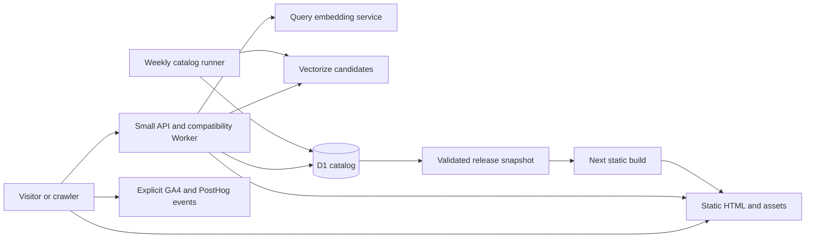

# Stupid Gifts launch and infrastructure specification

Date: October 19, 2026. Owner: Cameron. Canonical implementation epic:
`roadmap-lbbz1`. Baseline: `1a7ccb301f25dc129965fb71b32e0a682a86d604`.
Status: implementation specification; production migration and redesign have
not shipped.

## Purpose and decisions

Prepare the existing gift catalog for a recurring weekly segment on **Howie
Mandel Does Stuff** and the visitors it may bring. Optimize for products that
are funny at a glance, worth exploring, and actually purchasable. The first
success measure is qualified retailer clicks; affiliate earnings are the
business outcome. A broadcast date and audience volume have not been set.

Use **Stupid Gifts** as the proposed public identity and `https://stupid.gifts`
as the canonical destination. The owner authorized securing that exact domain.
The existing Goose site remains the production source until the staged
transition passes its gates. Keep the useful-absurdity editorial discipline:
outrageous objects, restrained presentation, accurate product facts.

The final architecture is:

- **Cloudflare Workers Static Assets** for prebuilt pages, catalog fragments,
  brand assets, and share images.
- **Next.js static export with existing React components** as the build tool.
  Retain the familiar codebase; eliminate request-time Next.js rendering.
- **A small TypeScript Worker** for semantic search, legacy query redirects,
  and freshness guards where serving a frozen page would be incorrect.
- **D1** as the operational catalog and maintenance-history database.
- **Vectorize** for existing 1,536-dimensional product embeddings.
- **The existing bounded weekly catalog runner**, adapted to D1 and a release
  pipeline. A separate daily publication check handles time-based expiry; it
  does not discover, enrich, or revalidate products through Amazon.
- **GA4 and PostHog** through the current explicit event adapter. No Vercel
  Analytics, new tracking vendor, per-view database writes, or new account
  system.

Budget for Workers Paid at $5/month account minimum plus measured overages,
embedding usage, and domain renewal. Check the existing account subscription
before buying anything: other apps share its allowances. D1 removes Neon's
awake-compute billing model, but inefficient queries still cost money.

This spec does not depend on a new SSR adapter, an Astro rewrite, a CMS,
Durable Objects, Queues, R2, recipient accounts, reminders, wishlists, or a
Secret Santa product. Add a service only when an observed requirement needs it.

## Current system and constraints

The current site uses Next.js 16.3.5, React 19, Vercel, Drizzle/Postgres,
Amazon Creators API, and OpenAI `text-embedding-3-small`. Public contact is
`goosegifts@37.technology`; keep that verified alias until a new product alias
is created and verified. Ownership remains Thirty Seven Inc.

The October 19 provider audit found 80.14 of 100 monthly Neon CU-hours used,
19.86 remaining, scale-to-zero enabled after five minutes, and compute capable
of suspending. That is an urgent runway issue, not evidence that the prior
cache work failed completely. Month-to-date extrapolation suggested October
24–25 exhaustion; remeasure before relying on that estimate.

The same audit counted 3,383 products, including 3,180 active products with
1,536-dimensional embeddings. Database size was about 80 MB by SQL and about
104 MB in provider storage accounting. These are sizing baselines, not
migration reconciliation totals. Recount at export.

Source locations that determine compatibility:

| Concern | Current implementation |
| --- | --- |
| Query-dependent homepage and feed | `app/page.tsx`, `components/CatalogSearchFeed.tsx`, `lib/db/operations.ts` |
| Semantic and keyword search | `app/api/search-products/route.ts`, `lib/db/product-search.ts`, `lib/openai-embeddings.ts` |
| Product identity and freshness | `lib/db/schema.ts`, `lib/gift-slugs.ts`, `lib/db/gift-pages.ts` |
| Random selection and shared links | `app/random-gift/page.tsx`, `lib/db/random-gift.ts` |
| Dynamic share cards | `app/api/og/random-gift/route.tsx` |
| Guides and original index | `lib/gift-guides.ts`, `app/gift-guides/`, `app/weird-gift-index/` |
| Redirects and site identity | `lib/legacy-redirects.ts`, `lib/site.ts`, `next.config.ts` |
| Catalog maintenance and receipts | `scripts/ops/catalog-weekly.mjs`, `prefetch-catalog.mjs`, `catalog-telemetry.mjs` |
| Events and privacy | `lib/client-analytics.ts`, `lib/analytics-contract.ts`, `lib/client-attribution.ts` |

Preserve immutable product IDs, public UUIDs, slugs and slug history, source
facts and hashes, editorial holds, duplicate families, freshness decisions,
review provenance, job IDs, and append-only operational history. Do not
resurrect retired bundle pages, the admin dashboard, or detailed click writes.

## Serving architecture

Create isolated staging and production D1 databases, Vectorize indexes, Worker
bindings, and publication credentials. Resource names follow
`stupid-gifts-{environment}`; IDs must come from provider creation responses.
Use the existing `37.technology` Cloudflare account, which also owns
`goose.gifts`. Do not reuse another app's database, index, or secrets.

### Routes and behavior

| Current or new URL | Final implementation and compatibility |
| --- | --- |
| `/` | Prebuilt curated opening selection, crawlable product links, progressively loaded static feed; a thin Worker checks snapshot expiry without D1 access. |
| `/?q=...` | Same static shell; client reads query and calls the search API. Search results remain usable/bookmarkable; the root Worker sets `X-Robots-Tag: noindex, follow` on query variants. |
| `/search` | Preserve its current redirect/query behavior in Worker routing; do not turn it into an unrelated page. |
| `/api/search-products` | Worker semantic search with the existing response shape, bounded diagnostics, keyword fallback, and abuse limits. |
| `/api/catalog-feed` | Preserve bounded POST compatibility using the published catalog artifact, not D1. New browsing uses small static feed shards. |
| `/gifts` and pagination | Static directory pages. Move pagination to `/gifts/page/2` etc.; redirect existing `?page=N` links with correct canonical and boundary behavior. |
| `/gifts/[slug]` | Prebuilt product HTML, metadata, related products and share card. Thin Worker expiry guard serves the asset or a safe noindex fallback without querying D1. Existing slugs do not change for branding. |
| `/gift-guides` and `/gift-guides/[slug]` | Prebuilt existing guides with current eligibility and internal links. |
| `/random-gift` | Static useful initial selection plus client-side spinning over a bounded versioned eligible pool. No DB request per spin. Preserve no-immediate-repeat and share behavior. |
| `/random-gift?gift=...` | Resolve through a deployed ID-to-slug map; preserve the existing permanent redirect and tracking allowlist. Unknown IDs get the generic random page, not a DB lookup. |
| `/api/og/random-gift?gift=...` or `?slug=...` | Map to prebuilt share assets; return the branded fallback for unknown inputs. No remote fetch or image rendering per request. |
| `/weird-gift-index` and `/weird-gift-index/data` | Static dated analysis and allowlisted public data generated together; preserve citation, methodology, schema, and contact identity. |
| `/privacy`, robots, sitemap and verification files | Static artifacts. Retain `/sitemap/0.xml` compatibility while publishing `/sitemap.xml` directly. |
| Existing legacy top-level slugs | Carry over the explicit redirect map. Unknown routes return a real 404, never the homepage with a 200. |
| `/howie` | New static weekly selection and links to the actual products; previous episodes remain reachable. |
| `/howie/[episode]` | Stable dated episode page, exact product variants, show order, archived alternatives for unavailable items. |
| Authenticated catalog publication endpoint | Replace Next cache invalidation with authenticated build dispatch/status. An accepted dispatch is not a completed release. |

Keep Worker routing explicit: root, catalog/guide/product/episode pages,
random, catalog data and sitemap go through a small bundled-manifest expiry
check; API and legacy paths have their specific handlers. CSS, JavaScript,
owned images, fonts, privacy and other timeless assets use direct asset
serving. A Worker execution still counts as a request even when it returns
prebuilt HTML. This design removes database and rendering work from browsing,
but does not promise every page view is free.

### Next.js refactoring

Use `output: 'export'`; generate finite dynamic paths with
`generateStaticParams()` from a validated snapshot. Remove runtime
`searchParams` reads, `force-dynamic`, ISR/revalidation, request-dependent
metadata, and Next redirects/rewrites from the exported app. Move dynamic
handlers outside `app/` into `workers/site/`. Client query handling must
hydrate cleanly, retain back/forward behavior, cancel superseded searches,
and show loading, empty, and unavailable states.

A publication build reads one local immutable snapshot; components do not
open a database connection during rendering. Export the directory's complete
path list, all maintained guide pages, product pages including safe held-page
responses, legacy maps, and episode pages. Guard against accidentally
exporting raw source facts, embeddings, internal notes, or credentials.

Reuse `ProductGrid`, `ProductImage`, retailer CTA and sticky mobile CTA,
search/feed UI, analytics adapter, ranking/deduplication functions and
structured-data helpers. `ProductImage` already uses `unoptimized`; audit the
remaining image components rather than adding a new image service. Prebuild
owned assets at sensible widths. Merchant images remain on approved merchant
CDNs; verify their applicable caching/content license before copying them or
embedding them in durable generated assets.

Suggested small module boundaries, not a new generic platform:

- `lib/catalog/`: pure types, eligibility, ranking, deduplication and links.
- `lib/catalog/storage/`: temporary Postgres adapter, D1 adapter, snapshot reader.
- `workers/site/`: search, compatibility, freshness and publication authorization.
- `scripts/catalog/`: export/import/reconcile, snapshot and publish commands.
- `content/show/`: versioned episode manifests using stable public product IDs.

Delete obsolete provider wrappers only after all maintained CLI and prototype
consumers have moved. The private ChatGPT prototype has a separate owner and
acceptance process: preserve its catalog contract, inventory its dependency,
and coordinate its data adapter before removing Neon access. Do not publish
or redesign that prototype as part of this website migration.

## Catalog data and search

### D1 data model

Preserve catalog semantics explicitly rather than mechanically importing a
Postgres schema:

| Postgres representation | D1 representation |
| --- | --- |
| UUID/product IDs/slugs | TEXT with the same values and unique constraints |
| Decimal money | Integer minor units plus currency; represent unknown price explicitly and preserve existing unknown-price behavior |
| Quality/similarity scores | REAL, with precision tolerance tested against exported values |
| Booleans | INTEGER restricted to 0/1 |
| Timestamp with timezone | UTC ISO-8601 TEXT with one canonical format |
| Historical timestamp without timezone | Interpret according to its documented writer semantics; test against known receipts, never guess local timezone |
| JSONB and tag arrays | Validated JSON TEXT; dedicated indexed columns for fields used in filters |
| Bigserial sequence | Preserve existing integer values/order; allocate new sequence atomically after the imported maximum |
| pgvector embedding | Vectorize plus a protected export copy; not a public JSON artifact |
| GIN/HNSW indexes | Purposeful D1 B-tree/FTS indexes and Vectorize cosine index |

Migrate active and inactive `products`, `product_slug_history`,
`catalog_runs`, `catalog_run_items`, `catalog_editorial_events`, and maintained
search diagnostics. Capture a complete protected export of every source table
including legacy bundles, relationships, clicks, admin actions and error logs.
Retired history may remain in a separately verified offline archive instead
of runtime D1, but every source table must have a recorded destination and
restoration test. No source data deletion is implied.

Add narrowly scoped `episodes` and `episode_products` data (or validated
version-controlled manifests) with episode key/date/status, product public ID,
display position, factual caption, approved asset, and replacement ID.
Choose manifests initially: no CMS or additional editorial database is needed.

Add `catalog_revision`/publication receipts and an idempotent vector-sync
outbox. D1 product update and outbox insertion are one transaction. The
maintenance runner drains the outbox, upserting/deleting Vectorize records;
each record includes source revision and embedding-text hash. A failed index
update remains retryable and visibly pending.

### Search behavior

Keep the existing embedding model and dimension during migration. Never
query an index with embeddings from a different model or dimension. Export
existing vectors without paying to regenerate all of them; recompute only
missing/changed inputs after the baseline is reconciled.

Use stable public UUIDs as Vectorize IDs, cosine similarity, and small
filterable metadata for eligibility and catalog revision. Retrieve bounded
candidates, fetch their D1 records in bounded indexed batches, then apply the
same eligibility, quality ranking and product-family deduplication. Treat
Vectorize metadata as a candidate filter, not final availability authority.
Keep the current retailer/product identity mapping for existing clients.

Preserve the current search result cap of 60. A maximum 240 candidates matches
the current overfetch intent; chunk D1 ID queries below its bound-parameter
limit. Do not silently replace search with a 3,000-row scan. Use an FTS5
keyword index for fallback and compare actual query plans/rows read.

Use a two-character minimum, 200-character maximum, bounded request size,
short provider timeout, and per-client rate limiting. Submit on search
intent/debounce, not every keystroke. Cache safe normalized results for five
minutes keyed by query hash, model version and catalog revision; purge by
revision on publish. The cache is an optimization, not a correctness or
globally strict spending lock.

Preserve first-party search diagnostics with capped fields and explicit
retention; do not forward raw query text to GA4, PostHog or general logs.
Logging failure must not fail a usable search. Include a configuration kill
switch for semantic search: if embedding/index quota or budget is exhausted,
serve keyword results and static browsing. Do not retry failed external calls
unboundedly. Search-provider failure must never blank the homepage or product
pages.

### Publishing and expiry

Every release has a manifest containing code SHA, catalog revision, generated
time, next expiry, product/slug counts, vector-sync watermark, content checksums
and the prior known-good release ID. Public files contain only approved
display fields. Shard feeds so a first visit does not download the whole
catalog.

Build and publish after an approved catalog/episode change, coalescing work
into one release. Retain the weekly catalog limits: 50 revalidations with the
published/legacy lanes, six rotating themes, existing new-item and editorial
caps, deduplication, factual checks and `--no-notify`. Replace invalidation
with a verified publication receipt. A provider HTTP 200 does not prove the
new catalog reached users.

Run one daily **publication freshness check**, separate from weekly discovery.
It reads the existing D1 snapshot only if needed and rebuilds when a known
eligibility/content expiry is approaching. It performs no paid generation or
Amazon requests. Maintain a single scheduled owner; do not duplicate existing
catalog or Pinterest jobs.

Preserve the 35-day indexability gate and stricter merchant-specific content
expiry rules. At build time compute each page's `eligibleUntil`. Bundle this
small expiry map in the Worker: after expiry serve a prebuilt safe noindex
variant and exclude expired entries from crawler sitemap responses, without
a database request. Keep price/offer claims out of the safe variant; preserve
useful navigation and a factual retailer link where permitted.

Homepage/episode/feed artifacts have their own earliest-expiry guard and safe
fallback as well; protecting only detail pages would still surface stale
recommendations. The Worker serves the normal asset while valid and a
prebuilt fallback when publication stalls. No browser-only timer can enforce
crawler-visible freshness. If a whole feed expires, show the safe browsing
message and maintained navigation; never replace an expired feed with empty
200 responses that look like a healthy catalog.

Generate an immutable release package and deploy its HTML, manifests, Worker
and owned assets as one version. Keep historical asset paths through the
cache lifetime to avoid broken client navigation after a deployment. Publish
only after vector outbox reconciliation, snapshot validation and route QA.
An urgent product removal triggers the same small release path with a target
of 10 minutes, not a week-long wait for discovery.

## Data migration and cutover

### Stage 0  Protect the current service

Remeasure Neon usage, time-to-exhaustion and active wake sources. Investigate
the remaining uncached `getProductById` calls on random/shared OG requests.
Any immediate patch must be narrowly verified; do not claim it eliminates
all compute. If migration cannot finish inside the remaining allowance,
present an exact temporary provider cost/term before upgrading. Do not use
quota pressure to rush a destructive cutover.

### Stage 1  Prove a complete vertical slice

In an isolated branch, publish a protected/noindex Cloudflare staging build
with the homepage, one guide, representative ready/held product pages, a
random spin, a legacy share URL, and real search over a small copied D1/vector
cohort. Use a staging analytics configuration that cannot pollute production.

Pass static export, asset routing, Worker expiry, D1 binding, Vectorize parity,
and mobile interaction checks before converting every route. The production
Vercel app continues serving its current version.

### Stage 2  Export and reconcile

1. Inventory every source table, count, key, foreign-key relationship, nullable
   field, time representation, maximum sequence and operational consumer.
2. Take a consistent, read-only export through the existing HTTPS Postgres
   path. Use a repeatable snapshot if supported; otherwise pause catalog
   writers briefly, export deterministically, and reconcile any diagnostic
   writes by high-water mark. Do not stream a live-changing multi-page catalog
   and call it a consistent backup.
3. Store encrypted/private export artifacts outside Git/public assets. Include
   table manifests, SHA-256 checksums, schema version and exporter revision.
4. Import into staging D1 in idempotent, size-bounded batches with preserved
   identities and uniqueness. Set explicit ordering and parent-before-child
   relationships; validate foreign keys and transaction boundaries.
5. Import vectors using the original values and an ID mapping manifest. Wait
   for index mutation visibility; compare count, dimension, ID coverage and
   representative query results. Count equality alone is not parity.
6. Reconcile all product IDs/public IDs/slugs/history, hashes, flags, money,
   timestamps and receipt sequences; record every approved transformation.
   Validate archived tables by restoring them into a disposable local database.
7. Compare a fixed 30-query search set, including recipient descriptions,
   exact products, typos, empty results and provider failures. Require no held
   or duplicate-family results and at least 80% top-10 overlap on the baseline
   set; manually review differences because approximate vector ranking may
   legitimately reorder candidates.

### Stage 3  Move writers and secrets

Keep Neon authoritative until the final write barrier. Avoid indefinite
dual-writing. Disable overlap between catalog runs during the barrier; record
the last successful run/revision, copy the final catalog delta, reconcile,
and change the runner to D1 exactly once. Resume only after a dry run proves
the new target and one bounded write/run produces durable receipts.

Cloudflare cannot export Worker secret values back to the local runner.
Therefore replace Vercel env-pull with an explicit protected operator
configuration in macOS Keychain (and protected CI secrets for release), and
deploy the required subset to Worker secrets. Keep `AMAZON_ASSOCIATE_TAG` in
one canonical non-secret catalog configuration consumed by runner, publisher
and tests; do not hardcode a second tag. Seed from the currently verified
Vercel Production value and record the configuration-source transition.

Inventory Amazon, OpenAI, analytics public keys/hosts, Pinterest OAuth
refresh, publication auth, and provider credentials by name and consumer.
Never put personal API tokens, exports or secrets in build output or Git.
Use project-scoped runtime credentials and isolate preview from production.
Replace the weekly heartbeat's `pull-env.sh` dependency only when the new
bootstrap has been exercised. Keep the Pinterest cohort measurement-only
until separately authorized; update URL/credential configuration without
publishing new Pins.

### Stage 4  Move hosting with the existing brand and domain

Serve the complete compatible site on Cloudflare staging first. Record the
current DNS, TLS, security, Vercel deployment and Neon recovery references.
Move `www.goose.gifts`/apex routing only after staging parity and restore
rehearsal pass. Preserve MX/TXT/email, verification records and unrelated
Cloudflare settings. Verify HTTPS, redirects and production browser events.

Hold the old deployment and a known-good data export for a seven-day
observation window. Leave Neon suspended where possible; repeated health
checks must not keep it awake. Recovery after D1 writes requires exporting
the D1 delta back to the restored source before re-enabling the old writer.
Simply switching DNS to stale Neon is not a valid rollback.

### Stage 5  Launch the new brand

After infrastructure is stable, launch the approved visual treatment on
`stupid.gifts`. Redirect `www.stupid.gifts` to the apex and all Goose public
paths permanently to their matching new paths, preserving safe attribution
parameters and necessary search/share behavior. Keep at least a year of
redirects and preferably renew the old domain indefinitely.

Update canonical/OG/schema URLs, sitemaps, robots, public contact presentation,
favicons, web manifests, social/share assets, legal ownership, analytics
production-host allowlists and Google stream settings. Keep GA4
`G-6RR3HPR747`, Google Ads `AW-17626116539` and the existing Goose PostHog
project so measurement remains continuous. Verify one stored page event and
one stored retailer event in each provider, with QA traffic identified.

Register the new site in the Amazon Associates approved site list and any
active affiliate program before monetizing the new domain. Retain the
verified tag; a rebrand is not a new affiliate account. Verify Pinterest
claimed-site/app metadata and existing Pin destination redirects; do not
delete old Pins. Coordinate Search Console verification, sitemap submission,
Change of Address and Bing/IndexNow with the existing search-submission owner.
Track actual provider receipts separately from website code completion.

Only retire Vercel/Neon after the observation window, verified restoration,
maintained consumer migration and secret-bootstrap replacement. Source data
deletion and paid subscription changes require their own concrete action
approval; removing an app dependency is not permission to delete its history.

## Visual design and show experience

### Editorial direction

**Stupid Gifts** should feel like a well-designed collection of very bad ideas.
Keep the interface confident and quiet so the objects provide the joke.
Suggested lead: “Ridiculous gifts. Excellent taste.” Treat this as a design
direction, not mandatory copy on every surface.

Use warm paper, near-black type, and the existing warm orange as a restrained
accent. Start with the current accessible burnt orange `#c2410c` for small
interactive text; check contrast in context. Use clean Inter typography,
moderate weights, generous product image space, and short captions. Avoid a
giant introductory paragraph, novelty fonts, shouting sale banners,
stickers on every tile, and a wall of equally weighted mugs.

The goose can remain a tiny signature or easter egg. It must not confuse the
new name or occupy space needed for products. Do not introduce a new mascot
system. Do not publish “as seen on” claims, show logos, clips, endorsements or
host imagery before the relevant appearance/asset permission is confirmed.

### Homepage and episode layout

First viewport, desktop: compact wordmark/nav, one short line of positioning,
then a large lead product and two visually distinct secondary products.
Search remains easy to find. Mobile: wordmark, short line, first product image
and an obvious product action within the initial viewport; subsequent cards
follow without a long hero.

Use “This week's questionable decisions” as a candidate section label.
When there is an actual published episode, provide a clear “From the show”
entry and direct links to that week's products. Below the opening set, offer
collections such as “Desk crimes,” “Bathroom nonsense,” and “Gifts that
shouldn't work,” only where the catalog genuinely supports them. Preserve
occasion guides as a second browsing path.

`/howie` shows the current published episode, two or three lead products in
the order discussed, one factual sentence each, a visible retailer action,
and previous weeks. Draft episodes are absent from public routes. Each
`/howie/[episode]` URL remains stable; if an item becomes unavailable, say so
and offer a clearly labeled substitute rather than silently rewriting history.

Provide an optional presentation view driven by the same episode manifest:
large image, concise name, one dry line, previous/next keyboard controls and
visible `stupid.gifts` domain. It must be readable when screen-shared at 720p,
work without surprise modals or auto-playing media, and be separate from the
normal visitor navigation only by presentation. Prefer a local/client mode
over building another application. A QR code can point to the stable episode
URL, with an ordinary link alongside it.

### Curation rubric

Choose the opening 12 products manually with this explicit rubric; prepare
four draft weekly sets of two or three products. These are editorial
shortlists, not a demand to buy physical samples.

| Criterion | Weight | What earns a high score |
| --- | --- | --- |
| Immediate visual absurdity | 30 | The product is surprising without reading a paragraph |
| Reaction and conversational potential | 25 | Gives the host a genuine question, reaction or demonstration |
| Giftability | 20 | A believable recipient and reason to give it |
| Product and image clarity | 15 | Exact variant, scale, quantity and function are apparent |
| Practical availability/value | 10 | Current retailer evidence and a plausible buying decision |

An actual product, factual image/copy, available offer and distinct product
family are hard gates, regardless of score. Outrageousness does not override
those gates. No generic commodity qualifies merely because generated copy
calls it funny. Include variety of scale, category and price; at most two
similar formats in the opening 12. Do not imply that AI scenes are the
physical product in use or that generated editorial was personally tested.

During preparation, refresh the small selected show cohort once before its
release rather than expanding the weekly discovery budget. Confirm any item
expected to be physically demonstrated is actually obtained and matches the
listing; a listing photograph is not proof of sample possession.

### Measurement

Keep existing events: `page_view`, `search`, `view_item_list`, `select_item`,
`conversion_event_outbound_click`, and `random_gift_spin`. Use `ui_context`
and the existing coarse campaign fields to distinguish homepage, show
episode, product page and random browsing. Preserve DNT/GPC, preview/local
suppression, and no autocapture/replay/form-text collection.

Description/QR links use a stable campaign naming convention, for example
`utm_source=howie_mandel_does_stuff&utm_medium=podcast&utm_campaign=episode_YYYY_MM_DD`.
Typed visits are direct/unknown; do not attribute all direct traffic to the
show. Compare before/after and tagged sessions while acknowledging that gap.

Report seven-day qualified visits, product selections, unique retailer-click
sessions, click-through rate with its denominator, and affiliate earnings at
the granularity the merchant actually provides. A click is not a purchase.
Distinguish internal QA and likely automation, and label provider gaps rather
than treating missing PostHog data as zero people.

## Cost and capacity model

Official pricing checked October 19, 2026; allowances are account-wide.

| Resource | Paid included allowance | Overage |
| --- | --- | --- |
| Workers | $5/month minimum; 10M requests and 30M CPU-ms | $0.30/M requests; $0.02/M CPU-ms |
| D1 | 25B rows read, 50M rows written monthly; 5GB storage | $0.001/M reads; $1/M writes; $0.75/GB-month |
| Vectorize | 50M queried dimensions/month; 10M stored dimensions | $0.01/M queried; $0.05/100M stored |
| Direct static assets | No request/bandwidth charge for direct asset serving | Worker-invoked routes still meter Worker usage |

With 3,180 active vectors at 1,536 dimensions, baseline vector storage is
4,884,480 dimensions. Query-only Vectorize overage is about $1.04 at 100,000
semantic searches/month and $14.86 at one million, before index updates and
embedding API costs. These are component estimates, not total bills.

For an illustrative 100,000 visits/month, five HTML views each and 10% of
visits searching, there are 500,000 page views and 10,000 searches. Even if
all HTML needs a thin 2ms Worker guard, that is about 1M CPU-ms before search
CPU. Estimate D1 row reads from measured query plans, not visitor counts.
Use actual account usage to decide whether shared included allowances cover
the launch. Build minutes, image transformations, logs, backups and any new
service are separate line items if enabled.

D1 Paid has a 10GB limit per database and each database executes queries
serially. The current catalog is small; indexed reads and short writes matter
more than storage today. Paying $5 does not remove architectural limits.
Keep browse traffic off D1, batch maintenance, inspect rows-read metrics,
set provider usage alerts and a search cost fallback. A local rate limiter or
cache is not a guaranteed global bill cap.

## Acceptance and release checks

These are targets to demonstrate in staging, not claims about current capacity.

1. **Route parity:** automated old/new route matrix covers every row above,
   query variants, empty results, invalid IDs, expired/held products, aliases,
   real 404s, mobile history navigation and no-JavaScript product links.
2. **Data:** zero unexplained differences in stable identities, source hashes,
   editorial/availability/duplicate state and receipts; all source tables
   accounted for; vector ID/dimension coverage exact; archive restoration
   succeeds.
3. **Privacy and affiliate:** no raw query/affiliate URL in third-party
   analytics, no secrets in assets, preview/DNT/GPC suppression, one verified
   current affiliate tag, correct merchant navigation with blocked analytics.
4. **Search:** fixed relevance cohort passes; held results never promoted;
   keyword fallback works; arbitrary input and excessive request rate are
   bounded; D1 plans avoid whole-table scans for normal indexed lookups.
5. **Freshness:** advance a test clock beyond expiry, fail publication and
   interrupt vector sync. Pages, lists and sitemaps remain safe; failure cannot
   mark a release successful. Test partial-import restart and retry.
6. **Experience:** desktop, 390px mobile and 720p screen-share review; all
   first-view images load; layout shift below 0.1; target mobile LCP below
   2.5 seconds; readable contrast, keyboard access, reduced-motion behavior,
   and no fabricated product features or misleading price.
7. **Burst rehearsal:** target staging at 100 requests/second for ten minutes,
   95% browse and 5% search, with under 0.1% unexpected errors. Use a mock
   embedding service for bulk load and only a bounded real search sample.
   Target static TTFB p95 under 300ms in the measured region and real search
   p95 under 2 seconds; record region/cache state and measured bills. Do not
   stress Amazon or trigger thousands of paid embeddings.
8. **Rollback:** restore the last static release and exercise a data restore/
   delta reconciliation. Record who can operate the recovery path.
9. **Production:** verify exact deployed version, both domain variants, TLS,
   redirects, representative pages/schema/sitemap, one real search and stored
   QA page/outbound events. Confirm affiliate site approval and host allowlists.
10. **Show readiness:** first episode manifest plus three reserve drafts, exact
    product links, availability refresh, large-screen walkthrough, and the
    release date coordinated with the owner. Do not invent an airing date.

## Delivery order and boundaries

1. Secure the domain; publish this specification and tracked work.
2. Protect current Neon runway and prove the static/D1/vector vertical slice.
3. Build the data adapters/export/import reconciliation and release machinery.
4. Complete route parity and move operations/hosting under the Goose domain.
5. Develop the Stupid Gifts visual treatment and four episode shortlists;
   review a composed desktop/mobile/show preview before brand cutover.
6. Launch domain/brand, coordinate affiliate and search providers, rehearse the
   show, observe for seven days, and retire obsolete providers safely.

Design/curation can progress alongside infrastructure. The critical path is
domain ownership, data integrity, a fast reliable landing experience, affiliate
eligibility and the first episode's real products. Broad catalog catch-up,
new feature work and expanding Pinterest creative are secondary. Existing
weekly maintenance and the frozen Pinterest measurement cohort continue;
this plan does not silently change their schedules.

Current approval is to produce the concrete spec and secure the domain.
Implementation tasks below are queued for execution; this document is not a
receipt that infrastructure was provisioned or traffic moved. Exact paid-plan,
registration-term and destructive retirement actions must satisfy the
applicable provider/approval requirements at execution.

## Sources

- [Next.js static export and unsupported runtime features](https://nextjs.org/docs/app/guides/static-exports)
- [Workers static assets](https://developers.cloudflare.com/workers/static-assets/)
- [Selective Worker routing](https://developers.cloudflare.com/workers/static-assets/routing/worker-script/)
- [Workers pricing](https://developers.cloudflare.com/workers/platform/pricing/)
- [D1 pricing](https://developers.cloudflare.com/d1/platform/pricing/)
- [D1 limits](https://developers.cloudflare.com/d1/platform/limits/)
- [Vectorize pricing](https://developers.cloudflare.com/vectorize/platform/pricing/)
- [Google domain moves](https://developers.google.com/search/docs/crawling-indexing/site-move-with-url-changes)
- Existing approved brand foundations: `~/roadmap/marketing/goose-gifts/BRAND.md`
  and `STRATEGY.md`. This launch brief changes the name/priority, not factual
  product standards or privacy boundaries.

## Implementation queue

Canonical Beads, in delivery order:

| Bead | Deliverable | Depends on |
| --- | --- | --- |
| `roadmap-lbbz1.1` | Specification and verified domain registration | Checkout completion |
| `roadmap-lbbz1.2` | Neon runway protection and Cloudflare vertical slice | Current provider evidence |
| `roadmap-lbbz1.3` | D1/vector migration and reconciliation | `.2` |
| `roadmap-lbbz1.4` | Complete static routes, publishing and hosting migration | `.3` |
| `roadmap-lbbz1.5` | Composed visual design and four episode shortlists | Can start alongside `.2` |
| `roadmap-lbbz1.6` | Domain/brand launch and conversion verification | `.1`, `.4`, `.5` |
| `roadmap-lbbz1.7` | Recoverable provider retirement | `.6` and observation window |

Implementation and domain ownership are separate evidence gates. Keep the
epic open until the launch acceptance criteria are actually satisfied.
